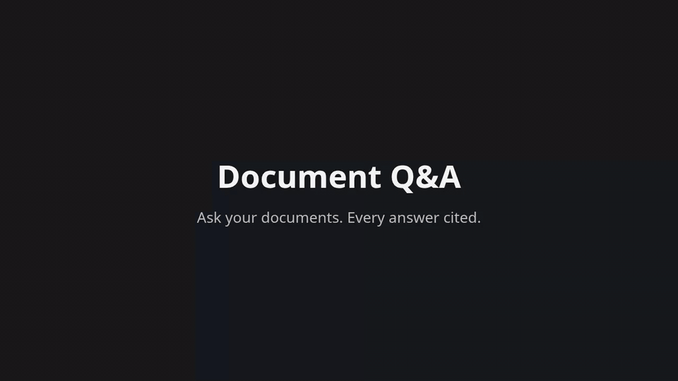
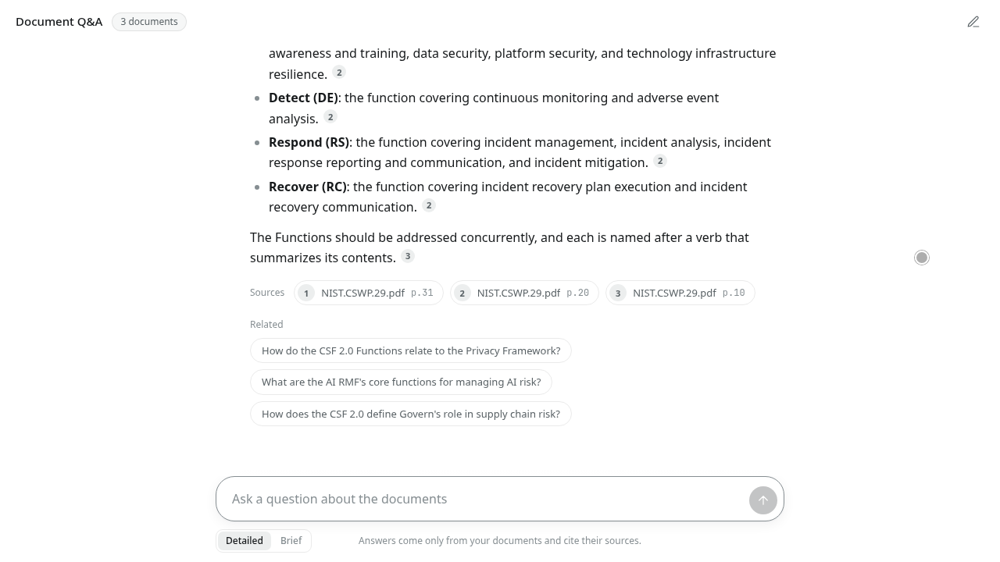
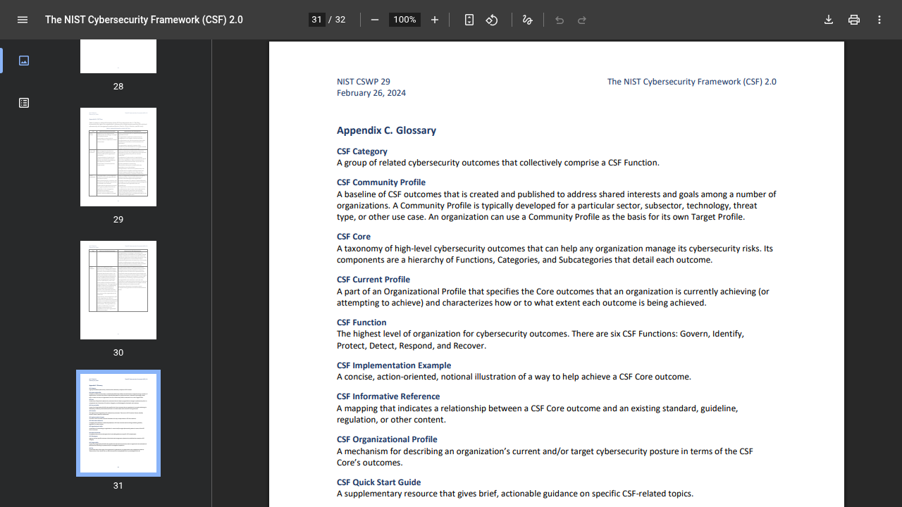
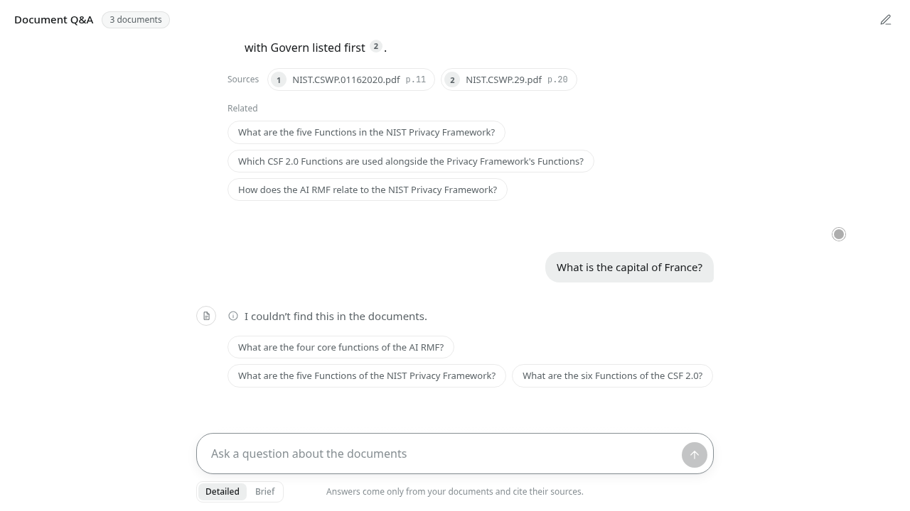
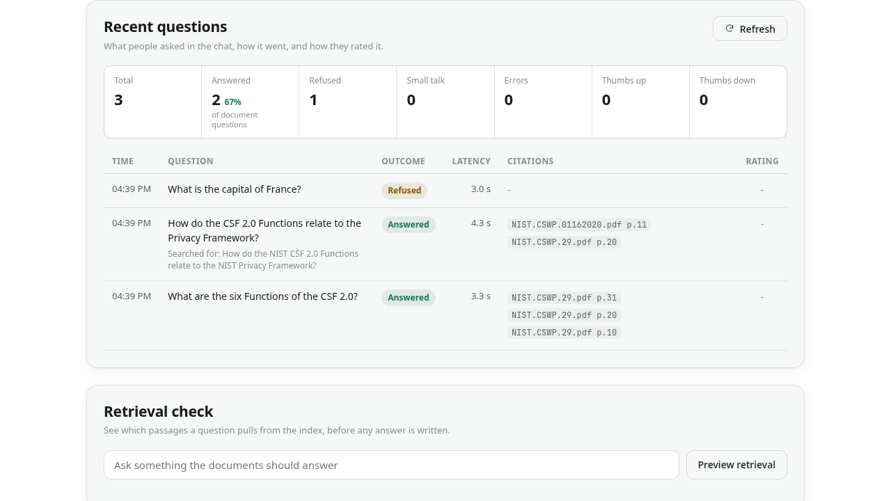
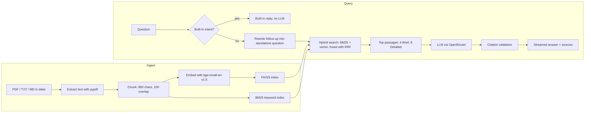

# Document Q&A chatbot (RAG demo)

Ask your documents. Every answer cited, or an honest "not in the documents".

[](LICENSE)
[](pyproject.toml)



58 s, real time, nothing sped up: upload a PDF → rebuild the index → cited answer streams in → open the cited PDF page → follow-up question → refusal → owner console. [Full-quality video (MP4)](docs/demo.mp4).

## Contents

- [Overview](#overview)
- [Features](#features)
- [Screenshots](#screenshots)
- [How it works](#how-it-works)
- [Quick start](#quick-start)
- [Configuration](#configuration)
- [Usage](#usage)
- [API](#api)
- [Project structure](#project-structure)
- [Evaluation & tests](#evaluation--tests)
- [Recording the demo](#recording-the-demo)
- [Limitations](#limitations)
- [Data & license](#data--license)

## Overview

A small retrieval-augmented chatbot that answers questions only from your documents. It runs locally as two apps: a chat for users and a console for the owner who manages the documents. Retrieval and embeddings run on your machine; only the answer step calls an LLM. It ships with three public NIST frameworks as sample data, and you can replace them with your own PDF, TXT or Markdown files.

Key guarantees:

- Answers come only from the indexed documents.
- Every claim cites its source as `[file, p.N]`.
- Citations are validated in code against the retrieved passages. Invalid ones are removed, and an answer with no valid citation is rejected.
- When the documents do not contain the answer, the bot says "I couldn't find this in the documents." instead of guessing.

### Design choices

- No UI framework: both apps are FastAPI + uvicorn with a hand-written HTML/CSS/JavaScript frontend in `web/` (no build step, no npm, no CDN; works offline).
- Hybrid retrieval: BM25 keyword search fused with FAISS vector search using Reciprocal Rank Fusion (k=60), which helps with exact terms such as category IDs (for example `RC.RP`) as well as paraphrased questions.
- No LangChain or agent framework: the pipeline is a few hundred lines of plain Python that you can read end to end.

## Features

### Chat experience

- ChatGPT-style centred conversation with numbered inline citation markers and a Sources row of chips under each answer.
- Answers stream token by token over server-sent events; the Stop button cancels an answer in progress.
- Detailed / Brief toggle (default Detailed): Detailed uses 8 retrieved passages and a thorough answer, Brief uses 4 and a concise one.
- Source chips expand to the exact passage (file, page, relevance) and link to the original PDF at that page. Sources from the same page are merged.
- Follow-up questions are rewritten into standalone ones using recent chat history; the UI shows "Searched for: ...".
- Up to 3 "Related" follow-up questions are suggested after each answer.
- Comparison questions (e.g. "compare X and Y") retrieve passages for each side.
- Thumbs up/down feedback, copy and regenerate on each answer. The conversation is kept in the browser's localStorage.
- Light and dark mode, mobile layout.

### Grounding & safety

- Citation validation in code: a citation must match the file and page of a retrieved passage.
- Refusal with example questions when the answer is not in the documents.
- Built-in replies with no LLM call for greetings, thanks, help, "list documents" and too-short input.
- Prompt-injection guard: messages that match common injection patterns get a built-in reply and never reach the LLM. Document text inside the prompt is marked as data, not instructions.
- Both apps bind to `127.0.0.1` and accept only `Host` 127.0.0.1 or localhost. Cross-origin POST and DELETE requests are rejected with 403.
- Only files in `data/` are served by the "Open page" link.
- Clean error messages for a missing key, an empty index, an empty question and API failure.

### Owner console

- Upload PDF/TXT/MD (50 MB limit per file), document list, delete with confirm.
- Rebuild index, index status with an out-of-date badge. Upload and delete are blocked while a rebuild runs.
- Retrieval preview: see which passages a question would retrieve.
- "Recent questions": questions asked in the chat with an answered % over document questions, plus user feedback.
- Needs no LLM key to manage documents.

## Screenshots

<table>
  <tr>
    <td width="50%"></td>
    <td width="50%"></td>
  </tr>
  <tr>
    <td align="center">Cited answer with numbered sources</td>
    <td align="center">Source chip opens the PDF at the cited page</td>
  </tr>
  <tr>
    <td width="50%"></td>
    <td width="50%"></td>
  </tr>
  <tr>
    <td align="center">Refusal when the documents lack the answer</td>
    <td align="center">Owner console: documents, index status, recent questions</td>
  </tr>
</table>

## How it works



- Chunks are 800 characters with 100 overlap, keep file name and page, and never cross pages.
- Embeddings are local (`BAAI/bge-small-en-v1.5`); vectors are stored in a FAISS index in `index/`.
- BM25 is implemented in the repo (no extra package) and fused with vector ranks using Reciprocal Rank Fusion, k=60.
- Brief answers use the top 4 passages after fusion, Detailed answers the top 8.
- The LLM sits behind one `generate()` function and can be swapped: `openrouter`, `anthropic` or `openai`.
- The running chat app picks up a rebuilt index automatically, without a restart.

## Quick start

```bash
git clone https://github.com/rahul2-byte/rag-document-chatbot.git && cd rag-document-chatbot
uv sync
cp .env.example .env    # then put your OPENROUTER_API_KEY in .env
uv run python -m src.ingest
uv run --env-file .env python -m src.app      # open http://127.0.0.1:7860
```

Then open the two apps:

| App | Command | URL |
|-----|---------|-----|
| User chat | `uv run --env-file .env python -m src.app` | http://127.0.0.1:7860 |
| Owner console | `uv run --env-file .env python -m src.admin` | http://127.0.0.1:7861 |

Pip alternative: `python -m venv .venv && pip install -r requirements.txt`.

## Configuration

Set these in `.env` (loaded with `--env-file .env`). Defaults come from the code.

| Variable | Default | Purpose |
|----------|---------|---------|
| `LLM_PROVIDER` | `anthropic` | LLM provider: `anthropic`, `openai` or `openrouter`. `.env.example` sets `openrouter`. |
| `LLM_MODEL` | none (required) | Model id for the chosen provider, e.g. `anthropic/claude-haiku-5.5` on OpenRouter. |
| `LLM_REASONING` | `off` | `off` or `on`. Applies only when `LLM_PROVIDER=openrouter`. `off` disables the model's hidden reasoning step. Measured on this project, it cut time-to-first-token from about 3.4–3.9 s to about 1.2–1.3 s, with the eval still 10/10. |
| `OPENROUTER_API_KEY` | none | Required when `LLM_PROVIDER=openrouter`. |
| `ANTHROPIC_API_KEY` | none | Required when `LLM_PROVIDER=anthropic`. |
| `OPENAI_API_KEY` | none | Required when `LLM_PROVIDER=openai`. |
| `PORT` | `7860` | Port for the user chat app (`src.app`). |
| `ADMIN_PORT` | `7861` | Port for the owner console (`src.admin`). |

## Usage

### Chat

1. Open http://127.0.0.1:7860 and ask a question, for example "What are the six Functions of the CSF 2.0?".
2. Pick **Detailed** for a thorough answer or **Brief** for a concise one.
3. Click a numbered source chip to see the exact passage, then **Open page N** to view the original PDF at that page.
4. Click a **Related** question to ask it, or type a follow-up such as "Which of those covers incident recovery?".

A question the documents cannot answer, such as "What is the capital of France?", gets a refusal with example questions.

### Owner console

Open http://127.0.0.1:7861 to:

- Upload PDF, TXT or MD files, then click **Rebuild index**.
- Delete a document (with confirm) and rebuild.
- Check index status: document and passage counts, last build, out-of-date badge.
- Run a retrieval preview to see which passages a question retrieves.
- Review **Recent questions**: outcome, answered %, and user feedback.

Without the console, drop `.pdf`, `.txt` or `.md` files into `data/` and run `uv run python -m src.ingest`. This rebuilds the index from scratch in one command.

## API

Both apps serve their page at `GET /`.

| App | Method | Path | Purpose |
|-----|--------|------|---------|
| Chat (7860) | GET | `/api/info` | Index status, document list and example questions |
| Chat (7860) | POST | `/api/ask` | Answer a question (full JSON response) |
| Chat (7860) | POST | `/api/ask/stream` | Answer a question as server-sent events |
| Chat (7860) | POST | `/api/followups` | Suggest up to 3 related questions |
| Chat (7860) | GET | `/docs/{name}` | Serve a source document from `data/` |
| Chat (7860) | POST | `/api/feedback` | Record thumbs up/down |
| Console (7861) | GET | `/api/status` | Documents and index status |
| Console (7861) | POST | `/api/upload` | Upload documents |
| Console (7861) | DELETE | `/api/documents/{name}` | Delete a document |
| Console (7861) | POST | `/api/rebuild` | Rebuild the index (409 if a rebuild is running) |
| Console (7861) | POST | `/api/preview` | Retrieval preview for a question |
| Console (7861) | GET | `/api/questions` | Recent questions and feedback |

## Project structure

```
.
├── src/
│   ├── ingest.py       load, chunk, embed, build the index, index metadata
│   ├── retrieve.py     load the FAISS index, BM25 keyword search, RRF fusion
│   ├── answer.py       prompt, generate() LLM wrapper, citation check, refusal
│   ├── intents.py      built-in replies (greetings, help, list documents, injection guard)
│   ├── qlog.py         question and feedback log (logs/*.jsonl) for the owner console
│   ├── app.py          user chat app (FastAPI, port 7860)
│   └── admin.py        owner console (FastAPI, port 7861)
├── web/                hand-written HTML/CSS/JavaScript frontend, no build step
│   ├── shared/         assets common to both apps
│   ├── chat/           user chat page
│   └── admin/          owner console page
├── tests/              unit tests (pytest)
├── eval/
│   ├── questions.json  10 evaluation questions (8 answerable, 2 unanswerable)
│   ├── run_eval.py     runs the questions through the pipeline and grades them
│   └── results/        latest eval output
├── data/               source documents (PDF/TXT/MD) and data/README.md
├── demo/               demo recording script and storyboard
├── docs/               demo GIF and video, screenshots
├── index/              generated index (faiss.index, chunks.json, meta.json); gitignored
├── .env.example        configuration template
├── pyproject.toml      project metadata and pinned dependencies (uv.lock)
└── requirements.txt    pip alternative
```

## Evaluation & tests

```bash
uv run pytest -q                                   # 209 unit tests
uv run --env-file .env python eval/run_eval.py     # 10-question eval
```

The eval needs a working LLM key because it calls the real pipeline.

### Latest eval result

Run on 2026-11-11 with LLM_MODEL=anthropic/claude-haiku-5.5 via OpenRouter, LLM_REASONING=off:

```text
q1    ANSWER  PASS  [NIST.AI.100-1.pdf, p.25], [NIST.AI.100-1.pdf, p.8], [NIST.AI.100-1.pdf, p.37] | cites expected page
q2    ANSWER  PASS  [NIST.AI.100-1.pdf, p.17] | cites expected page
q3    ANSWER  PASS  [NIST.CSWP.29.pdf, p.8], [NIST.CSWP.29.pdf, p.10], [NIST.CSWP.29.pdf, p.20] | cites expected page
q4    ANSWER  PASS  [NIST.CSWP.29.pdf, p.31], [NIST.CSWP.29.pdf, p.29] | cites expected page
q5    ANSWER  PASS  [NIST.CSWP.29.pdf, p.27], [NIST.CSWP.29.pdf, p.20], [NIST.CSWP.29.pdf, p.9] | cites expected page
q6    ANSWER  PASS  [NIST.CSWP.01162020.pdf, p.11], [NIST.CSWP.01162020.pdf, p.22] | cites expected page
q7    ANSWER  PASS  [NIST.CSWP.01162020.pdf, p.2], [NIST.CSWP.01162020.pdf, p.5] | cites expected page
q8    ANSWER  PASS  [NIST.AI.100-1.pdf, p.7], [NIST.AI.100-1.pdf, p.26] | cites expected page
q9    REFUSE  PASS  - | correctly refused
q10   REFUSE  PASS  - | correctly refused

Answerable with correct citations: 8/8
Unanswerable refused: 2/2
TOTAL: 10/10
```

LLM output varies between runs, so results can differ from the block above.

## Recording the demo

The demo is recorded by `demo/record_demo.cjs` with Playwright against the two running apps, in one continuous take with real waits. It writes `demo/out/demo.mp4` (not committed); the copy in `docs/` is the committed version.
See [demo/DEMO_SCRIPT.md](demo/DEMO_SCRIPT.md) for the storyboard, setup steps and settings.

## Limitations

- No authentication. Both apps bind to 127.0.0.1 and must not be exposed publicly without adding auth.
- The citation check is at page level: a citation is valid if its file and page match a retrieved passage.
- Conversation memory is limited. A follow-up question is rewritten into a standalone question using recent chat history, and that rewritten question is what retrieval searches.
- Scanned PDFs without a text layer are not supported (no OCR).

## Data & license

The sample documents are listed in [data/README.md](data/README.md), with source URLs and license basis:

| File | Title |
|------|-------|
| `NIST.AI.100-1.pdf` | Artificial Intelligence Risk Management Framework (AI RMF 1.0) |
| `NIST.CSWP.29.pdf` | The NIST Cybersecurity Framework (CSF) 2.0 |
| `NIST.CSWP.01162020.pdf` | NIST Privacy Framework, Version 1.0 |

These are US government works and are public domain in the United States (17 U.S.C. §105).

The code in this repository is released under the [MIT License](LICENSE). The MIT license does not apply to the PDFs in `data/`, which keep their own public-domain status.
